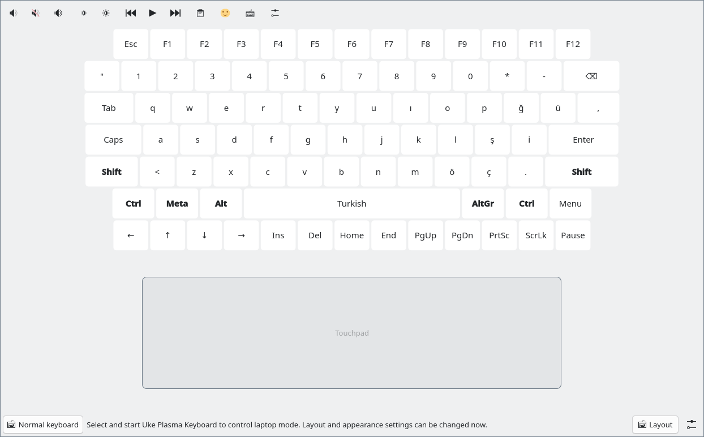

# Uke Plasma Keyboard Custom

A tablet virtual keyboard and laptop control surface for Fedora KDE Wayland.
This is a fork of [mops1k/plasma-keyboard-custom](https://github.com/mops1k/plasma-keyboard-custom),
based on KDE Plasma Keyboard. Upstream history, SPDX headers and licenses are
retained. KWin, Plasma and Qt remain original distribution packages.

The first target is the POCO Pad X1 (Uke), aarch64. The source discovers display,
touch and language capabilities rather than hardcoding a connector name.
Fedora 44, 45 and Rawhide builds are qualified independently.

## Modes

- Normal: a bottom-docked keyboard, with optional floating mode and original
  language input engines, themes, gamepad navigation and local voice input.
- Static laptop: an explicitly selected, persistent full-panel keyboard and
  touchpad. Requires an already enabled internal touchscreen and an extended
  external display. KWin integration keeps pointers and application windows
  on external displays. It never enables a display or changes screen layout,
  scale, orientation or interface language.
- Dynamic laptop: a movable keyboard/touchpad panel, opened manually from the
  tray by default, with optional text-focus activation. It leaves desktop
  pointer, window and refresh policy intact. Initial implementation; hardware
  qualification is pending.

Key sizing uses physical millimetres with a calibration ruler. Function,
modifier, arrow, navigation and system-key regions are independently selectable.
The touchpad supports tap, drag, scroll, pinch and three/four-finger gestures.
Its width, buttons and short typing guard are configurable.

Space dragging moves the text cursor; dragging left from Backspace deletes
words. Suggestions use optional original Fedora Hunspell dictionaries. Personal
learning is disabled by default. Password/unknown-content contexts do not expose
clipboard history, suggestions or emoji. Voice models are not downloaded or
loaded until requested.



The prototype above is rendered from the installed QML with synthetic input.
It shows the toolbar, PC keyboard and centered touchpad; physical touch and
display qualification are still pending.

## Installation and recovery

Install the signed `uke-plasma-keyboard-custom` RPM through its COPR repository,
then select **Uke Plasma Keyboard Custom** in System Settings → Virtual Keyboard.
Installation does not replace the selected input method. The original
`plasma-keyboard` package remains required and available for rollback.

On Fedora 44 or 45 aarch64:

```sh
sudo dnf copr enable mcc45tr/uke-plasma-keyboard-custom
sudo dnf install uke-plasma-keyboard-custom
```

On Rawhide aarch64, explicitly select the Rawhide chroot. Its repository name
does not follow Rawhide's numeric `$releasever`:

```sh
sudo dnf copr enable mcc45tr/uke-plasma-keyboard-custom fedora-rawhide-aarch64
sudo dnf install uke-plasma-keyboard-custom
```

When upgrading from 0.1.0-27 or earlier, the old watcher can miss an executable
replacement with unchanged size and timestamp. If the running version stays
old, reload the selected Uke provider once after DNF finishes:

```sh
uke-plasma-keyboard-custom --restart-input-method
```

This helper preserves a different provider selection made during the reload.
It does nothing when an unrelated keyboard is selected.

The KWin plugin is part of this RPM and must be rebuilt for each KWin ABI.
An incompatible plugin disables static mode with an explanation; it does not
force a KWin downgrade. Native code and native tests are built only in COPR.
There is no project Python runtime or build generator.

COPR [11315666](https://copr.fedorainfracloud.org/coprs/mcc45tr/uke-plasma-keyboard-custom/build/11315666/)
builds version 0.1.0-32 on all three targets, each with 35 passing CTests.
The tablet's DNF upgrade to 32 and native attachment are verified; the earlier
28 checkpoint also qualifies reinstallation and automatic provider renewal.
Physical laptop-mode and adaptive-refresh qualification remain open; see the
[first tablet trial](docs/device-trial.md) before using laptop mode.

See [architecture and source provenance](docs/architecture.md),
[acceptance status](docs/acceptance.md) and the retained
[upstream feature documentation](README.upstream.md).
